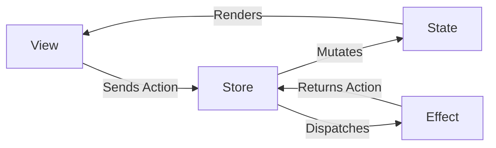

# Unidirectional Data Flow (UDF)

In UDF, state mutations are centralized and predictable.

---

## 1. The Core Loop



---

## 2. Lightweight Pure-Swift UDF Implementation

```swift
import SwiftUI
import Observation

@MainActor
@Observable
final class CounterStore {
    struct State {
        var count: Int = 0
        var isLoading: Bool = false
    }
    
    enum Action {
        case increment
        case decrement
        case loadAsync
        case didLoad(Int)
    }
    
    private(set) var state = State()
    
    func send(_ action: Action) {
        switch action {
        case .increment:
            state.count += 1
        case .decrement:
            state.count -= 1
        case .loadAsync:
            state.isLoading = true
            Task {
                try? await Task.sleep(for: .seconds(1))
                self.send(.didLoad(42))
            }
        case .didLoad(let val):
            state.count = val
            state.isLoading = false
        }
    }
}
```
